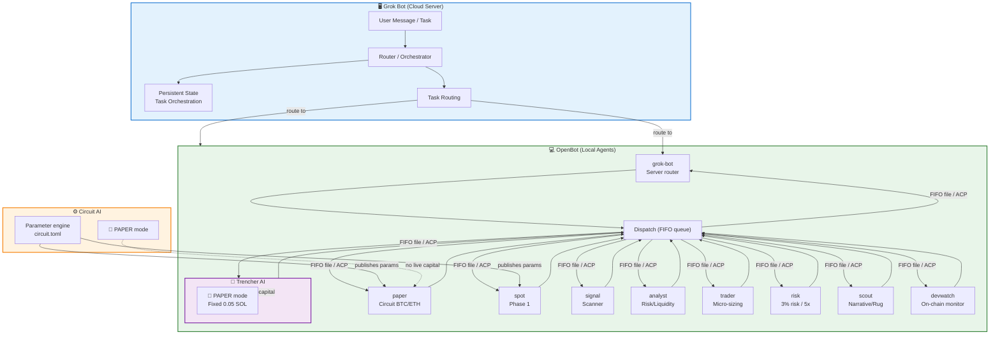

# Lyta Grok Bot Trading Desk — Platform Architecture

**Date:** 2026-11-07
**Status:** v2 — Grok Bot server + OpenBot agents separation
**Platform:** OpenBot + Grok Bot + Circuit + Trencher AI

---

## 1. Architecture Overview

The trading desk uses a **dual-platform separation**:

| Component | Platform | Role | Always-On? |
|-----------|----------|------|------------|
| **Grok Bot (server)** | Managed cloud VM (xAI) | Coordination, routing, persistent state, task orchestration | ✅ Yes — cloud stays up even when laptop closes |
|| **OpenBot (agents)** | Local desktop workspace (nightly-labs) | 12 trading agents — circuit paper, signal, analyst, trader, risk, scout, devwatch, trencher, spot, grok-bot | Runs on local machine; agents active when machine is on |

**Why this split:**
- Grok Bot provides **always-on availability** — the server stays running when your laptop closes
- OpenBot provides **multi-agent flexibility** — runs different coding agents (Codex, Claude, Grok CLI, etc.) in one workspace with inter-agent communication
- The **server/agent split** means the coordination layer is independent of the execution layer

### 2.3 Platform Comparison (Yes/No)

|| Question | Grok bot | OpenBot ||
|----------|----------|---------|
|| Local-first execution | ✅ Yes (cloud computer always on, local mode available) | ✅ Yes |
|| Data stays on your machine | ❌ No (cloud) | ✅ Yes |
|| Cost model | Self-hosted/managed plan | Free (non-commercial) |
|| Mobile app | ✅ Yes (iOS/Android) | ✅ Yes (iPhone/Android) |
|| Voice / dictation | ✅ Yes (voice input, voice chat) | ✅ Yes (31 languages) |
|| Backup models | ✅ Yes (cloud backup, multiple plans) | ✅ Yes |
|| Teams / roles | ✅ Yes (group chats, parallel bots, roles) | ✅ Yes (roles, shared channels) |
|| Chat / human-in-loop | ✅ Yes (text-thread interface) | ✅ Yes (approve actions) |
|| Schedule automation | ✅ Yes (cloud routines) | ✅ Yes (local sweeps) |
|| Source code | ✅ Open (lyta-grokbot-multi) | ✅ Open (openbot.io) |

**Notes:**
- **Grok bot** is the cloud coordination layer — always-on, accessible from mobile, voice, chat, team workflows
- **OpenBot** runs local agents — agents execute on your machine, data stays on your machine
- Both platforms are open-source: OpenBot `openbot.io`, Grok Bot `lyta-grokbot-multi` (public GitHub repo)

---

## 2. Component Roles

### 2.1 Grok Bot (Server/Router)

|| Aspect | Detail |
||--------|--------|
|| **Platform** | `grok-bot.app` (xAI/SMSCs) |
|| **Role** | Primary routing bot, task orchestrator, persistent coordinator |
|| **Key functions** | Task routing to right LYTA agent, session state, coordination between agents |
|| **Mode** | Paper-only (no live capital) |
|| **Workflow** | User message → Grok Bot identifies correct LYTA agent → routes task → agent executes → result returned |

**What Grok Bot does:**
- Routes incoming tasks to the correct LYTA agent (paper, signal, analyst, trader, risk, scout, devwatch, trencher)
- Maintains persistent coordination state across sessions
- Acts as the entry point for the trading desk

### 2.2 OpenBot (Agent Execution)

|| Aspect | Detail |
||--------|--------|
|| **Platform** | `openbot.io` (nightly-labs, PolyForm Noncommercial) |
|| **Role** | Local agent execution workspace with 12 trading agents |

**What OpenBot agents do:**
| Agent | Role | Status |
|-------|------|--------|
| `lyta-grok-desk-paper` | Circuit BTC/ETH papertrade (Phase 1) | Active |
\|\`lyta-grok-desk-spot\` | Circuit Papertrade spot trading (paper-only, 12-bot consensus) |
| `lyta-grok-desk-signal` | Scanner — market signal aggregation | Active |
| `lyta-grok-desk-analyst` | Rug risk, liquidity, score evaluation | Active |
| `lyta-grok-desk-trader` | Micro-sizing execution ($0.20–$0.85) | Active |
| `lyta-grok-desk-risk` | Risk (3% risk, 5x max, stand-down) | Active |
| `lyta-grok-desk-scout` | Narrative/rug signal check (GMGN + wallet) | Active |
| `lyta-grok-desk-devwatch` | On-chain wallet monitoring (Hrundel75) | Active |
|| `lyta-grok-desk-trencher` | TrenchesAI deployment monitor | Active |
|| `grok-bot` | Server router — routes tasks to LYTA agents | Active |

Communication: FIFO message queues + shared files + ACP (Agent Client Protocol).
Paper guards: `SIMULATION` + `paper_only` flags enforced on all agents.

### Platform Architecture Diagram



### 2.3 Circuit AI

|| Aspect | Detail |
||--------|--------|
|| **Role** | Parameter engine — holds `circuit.toml`, publishes platform parameters |
|| **Mode** | `PAPER` — paper-only trading |

### 2.4 Trencher AI

|| Aspect | Detail |
||--------|--------|
||| **Role** | Secondary platform (paper-only copy) — fixed-size buy, no dynamic sizing |
||| **Mode** | `PAPER` — fixed 0.05 SOL buy size (SOL on-chain; paper capital 1 SOL or $100 per platform) |

## 3. Data Flow

```
┌─────────────────────────────────────────────────────────────────┐
│  User (web UI / messaging)                                      │
└────────────────────────┬──────────────────────────────────────┘
                         │
                         ▼
┌─────────────────────────────────────────────────────────────────┐
│  GROK BOT (SERVER) — xAI managed cloud VM                       │
│  - Receives user requests                                       │
│  - Identifies target LYTA agent                                 │
│  - Routes tasks with context                                    │
│  - Maintains session state                                      │
└───────────────┬───────────────────────┬─────────────────────────┘
                │ task + context        │ result
                ▼                       ▼
┌─────────────────────────────────────────────────────────────────┐
│  OPENBOT (AGENTS) — local desktop workspace                     │
│                                                                 │
│  Agent 1: lyta-grok-desk-paper  (Circuit paper trading)         │
│  Agent 2: lyta-grok-desk-paper (spot trading, paper)    │
│  Agent 3: lyta-grok-desk-signal  (Signal generation)            │
│  Agent 4: lyta-grok-desk-analyst (Analyst evaluation)           │
│  Agent 5: lyta-grok-desk-trader  (Micro-sizing execution)       │
│  Agent 6: lyta-grok-desk-risk    (Risk management)              │
│  Agent 7: lyta-grok-desk-scout   (Narrative/rug signal check)   │
│  Agent 8: lyta-grok-desk-devwatch (On-chain wallet monitoring)  │
│  Agent 9: lyta-grok-desk-trencher (TrenchesAI deployment mon.)  │
│  Agent 10: grok-bot               (Server router)               │
│                                                                 │
│  Communication: FIFO message queues + shared files              │
│  E2E: ACP (Agent Client Protocol) between agents                │
└─────────────────────────────────────────────────────────────────┘
                         │
                         ▼
┌─────────────────────────────────────────────────────────────────┐
│  CIRCUIT AI (parameter engine)                                  │
│  - circuit.toml config                                          │
│  - Platform parameters (BTC/ETH papertrade, consensus, etc.)    │
└─────────────────────────────────────────────────────────────────┘
```

---

## 4. Platform Comparison (Corrected)

This table separates **host capability** from **application architecture**.

| Criterion | Grok Bot | OpenBot | Hermes Agent |
|-----------|----------|---------|--------------|
| **Execution locus** | Managed cloud VM (account-scoped) | Local desktop | Your choice: local, Docker, SSH, etc. |
| **Always-on** | ✅ Yes — core claim | ❌ No — needs running host | Conditional — can daemonize |
| **Agent count** | Multiple named Bots | Unlimited agents in one workspace | Subagents with isolated terminals |
| **Inter-agent communication** | Shared cloud computer, separate conversations | FIFO queues, shared files, ACP | MCP client + server |
| **Isolation between agents** | None by design — shared computer | Per-agent workspace, `danger-full-access` | Per-session/per-subagent, smart approval |
| **Credential custody** | Stored on cloud computer | Your local CLI logins | Your choice of secret store |
| **Model flexibility** | Grok-native, no model picker | High — 10+ providers, local models | High — Nous Portal, OpenAI, Anthropic, etc. |
| **License** | Proprietary | PolyForm Noncommercial | MIT |

**Key insight:** Grok Bot's strength is **always-on availability**. OpenBot's strength is **local agent flexibility** with multiple providers. They complement each other — Grok Bot routes tasks, OpenBot executes them.

---

## 5. Tooling

| Component | Purpose |
|-----------|---------|
|| `paper_desk_simulator.py` | Paper trading simulation engine (config v3 + 12-bot consensus) |
|| `lyta-grok-desk/` | OpenBot agent workspace (index.ts, circuit.toml, prompts) |
|| `circuit_ai_prompt.txt` | Circuit AI parameter configuration |
|| `Trencher AI` | Secondary paper-only fixed-size copy |
|| `AGENTS.md` | OpenBot agent operating rules |
|| `pumpfun_desk_simulator.py` | Phase 2 pump.fun memecoin simulator (paper-only) |
|| `pumpfun_adapter.py` | Pump.fun adapter + trade generator |
|| `config/pumpfun_desk_config.txt` | Phase 2 config (trading rules, agent roles, guard gates) |

---

## 5b. Phase 2 — Pump.fun Memecoin Trading (Paper-Only)

The Phase 2 pump.fun Solana memecoin desk is **paper-only** and mirrors the existing
circuit paper trading setup. It is fully simulated, with Telegram alerts wired for
instant signal/entry/exit visibility.

### Paper-Only Guarantees

- **No real capital** — $100 paper balance hardcoded in `_paper_agent.ts` and
  `collateral = 100.0` fallback in `circuit.toml`
- **No wallet import** — `no_wallet_import` guard blocks `import solana`,
  `sellers`, `web3`, `eth_account`
- **No signing/order execution** — `no_signing_or_order_execution` guard blocks
  `send_transaction`, `sign_transaction`, `place_order`, `execute_swap`
- **Paper labels** — every simulation file requires `PAPER ONLY` + `SIMULATION`
  labels
- **Shared state** — all simulation state includes `paper_only: true`

### Agent Roles (13 total)

| Agent | Role |
|-------|------|
| SCOUT | Narrative/rug signal checker (GMGN + wallet analysis) |
| FILTER | Low-quality pump filter (>5% 24h, >$50k volume) |
| ANALYST | Rug risk, liquidity, score evaluation |
| PUMP_CHASER | Momentum accumulation engine (>7% 24h) |
| CONVICTION | Trend/filter validator (rugScore <0.35) |
| MOMENTUM | Momentum collector (>4% 24h + >$50k volume) |
| SCALPER | High-vol scalper (>2.5% both directions) |
| CONTRARIAN | Downtrend opportunity finder (<-6% 24h, rugScore <0.5) |
| TREND | Trend follower (>5% 24h + >$50k volume) |
| RESEARCHER | On-chain research agent (liq >$50k + rugScore <0.28) |
| PORTFOLIO | Position sizing manager (3% risk, 5x max) |
| EXECUTOR | Final micro-sizing executor ($0.20–$0.85) |
| PAPER | Paper trading agent (Circuit BTC/ETH) |

### Trading Rules (Phase 2)

- Buy only when >=7 of 12 bots vote BUY (min=7, max=10, default=7)
- Skip coins up >100% in the past hour (max_h1_pump_pct=100)
- Skip coins with liquidity < $50,000 (min_liquidity_usd=50000)
- Stop loss: sell whole position at -35% from entry (stop_loss_pct=35)
- Take profit: sell whole position at +50% from entry (take_profit_pct=50)
- Exit check first every 15min run (exits checked before any entry)
- Stand-down messages name the active buy filters when nothing qualifies

### Trading Desk Dashboard (overall summary)

The trading desk is the single source of truth for the running paper session.
It aggregates bot votes, positions, PnL, and alerts into one unified view that
can be shown on Telegram or OpenBot.

**Key files:**
- `lyta-grok-desk/trading_desk.py` — `TradingDesk` class (state + terminal/HTML render)
- `lyta-grok-desk/trading_desk_cli.py` — CLI entry point

**Usage:**
```bash
# Terminal mode: print the desk summary every 10 seconds
python3 lyta-grok-desk/trading_desk_cli.py

# One-shot (print summary once and exit)
python3 lyta-grok-desk/trading_desk_cli.py --once

# HTML mode: render a full HTML dashboard for Telegram/OpenBot
python3 lyta-grok-desk/trading_desk_cli.py --html
```

**What it shows:**
- Overall capital, open positions, closed positions, realized PnL
- Bot vote consensus (all 13 agents with buy/sell/pass tallies)
- Open position detail (asset, side, entry price, bots, PnL)
- Alerts (open, close, stand-down, vote results)
- HTML dashboard ready for Telegram/OpenBot progress viewing

### Telegram Alert Wiring

Every Phase 2 agent uses `deps = ["telegram:alert"]` so any signal, entry, stop
loss, take profit, or stand-down emits a Telegram alert.

The `TelegramAlert` class in `pumpfun_desk_simulator.py` provides:
- `alert(message, level)` — general alert (logged locally, pushed to Telegram)
- `open(position, asset, entry, side, bots, collateral)` — entry alert
- `close(asset, side, price, pnl)` — exit alert
- `stand_down(reason)` — stand-down alert
- `vote_results(asset, votes)` — vote tally alert

When `TELEGRAM_BOT_TOKEN` is set, alerts push to Telegram. Otherwise, they are
logged locally only (paper mode), and the trading desk dashboard still renders
the same alerts for the overall summary view.

### Secrets & Credentials

- `TELEGRAM_BOT_TOKEN` — optional, for real Telegram push in Phase 3
- `PUMPFUN_API_KEY`, `BIRDEYE_API_KEY` — paper-only, keep blank
- Never commit real values. Use `.env.example` for the template.

---

## 6. Platform Decision Log

| Version | Platform Split | Rationale |
|---------|---------------|-----------|
| v1 | Conflated all platforms into one table | Original comparison had 1 agent vs 12 agents, conflating host with application |
|| v2 | **Grok Bot (server) + OpenBot (agents)** | Grok Bot = always-on cloud server; OpenBot = local multi-agent execution; Hermes as migration target if needed |
|| v10 | **Tightened paper parameters** | PO_STOP_LOSS 0.82, PO_TRAIL 3.0, PO_MIN_BUYS 4, PO_MAX_POOL_FEE 0.04, PO_POSITION_MULT 1.2, PO_ENTRY_MAX 72; trial_mode v10_tuned (v9 historical) |
||| v11 | **Repo health pass** | Removed "What Needs Wiring" section; agent roster updated to 12 agents across README, ARCHITECTURE, AGENTS.md, README_circuit.md; docs index added; BOT-COMPARE reworded to yes/no contrast with no "winner" column |
||| v12 | **Platform comparison corrected** | Grok Bot confirmed to have mobile app, voice, backup models, teams/roles, chat/human-in-loop, schedule automation, source code (was incorrectly marked as lacking these) |
||| v13 | **Build stack documented** | Added Solar Mini4, Grok 4.7, inkling, chatgpt sol to repo documentation |

---
