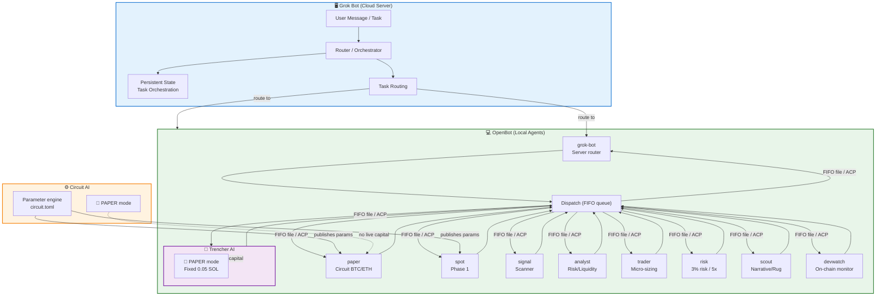

# Lyta Grok Bot Trading Desk — Platform Architecture

**Date:** 2026-11-07
**Status:** v2 — Grok Bot server + OpenBot agents separation
**Platform:** OpenBot + Grok Bot + Circuit + Trencher AI

---

## 1. Architecture Overview

The trading desk uses a **dual-platform separation**:

| Component | Platform | Role | Always-On? |
|-----------|----------|------|------------|
| **Grok Bot (server)** | Managed cloud VM (xAI) | Coordination, routing, persistent state, task orchestration | ✅ Yes — cloud stays up even when laptop closes |
|| **OpenBot (agents)** | Local desktop workspace (nightly-labs) | 10 trading agents — circuit paper, signal, analyst, trader, risk, scout, devwatch, trencher, spot, grok-bot | Runs on local machine; agents active when machine is on |

**Why this split:**
- Grok Bot provides **always-on availability** — the server stays running when your laptop closes
- OpenBot provides **multi-agent flexibility** — runs different coding agents (Codex, Claude, Grok CLI, etc.) in one workspace with inter-agent communication
- The **server/agent split** means the coordination layer is independent of the execution layer

### 2.3 Platform Comparison (OpenBot vs Grok Bot)

| Question | OpenBot | Grok Bot |
|----------|---------|----------|
| Local-first execution | ✅ Yes | ✅ Yes (cloud computer always on, local mode available) |
| Data stays on your machine | ✅ Yes | ❌ No (cloud) |
| Cost model | Free (non-commercial) | Self-hosted/managed plan |
| Mobile app | ❌ No | ✅ Yes (iOS/Android) |
| Voice / dictation | ❌ No | ✅ Yes (voice input, voice chat) |
| Backup models | ❌ No | ✅ Yes (cloud backup, multiple plans) |
| Teams / roles | ❌ No | ✅ Yes (group chats, parallel bots, roles) |
| Chat / human-in-loop | ❌ No | ✅ Yes (text-thread interface) |
| Schedule automation | ✅ Yes (local sweeps) | ✅ Yes (cloud routines) |
| Source code | ✅ Open (openbot.io) | ✅ Open (lyta-grokbot-multi) |

**Notes:**
- OpenBot runs **local agents** — agents execute on your machine, data stays on your machine
- Grok Bot is the **cloud coordination layer** — always-on, accessible from mobile, voice, chat, team workflows
- Both are open-source: OpenBot `openbot.io`, Grok Bot `lyta-grokbot-multi`

---

## 2. Component Roles

### 2.1 Grok Bot (Server/Router)

|| Aspect | Detail |
||--------|--------|
|| **Platform** | `grok-bot.app` (xAI/SMSCs) |
|| **Role** | Primary routing bot, task orchestrator, persistent coordinator |
|| **Key functions** | Task routing to right LYTA agent, session state, coordination between agents |
|| **Mode** | Paper-only (no live capital) |
|| **Workflow** | User message → Grok Bot identifies correct LYTA agent → routes task → agent executes → result returned |

**What Grok Bot does:**
- Routes incoming tasks to the correct LYTA agent (paper, signal, analyst, trader, risk, scout, devwatch, trencher)
- Maintains persistent coordination state across sessions
- Acts as the entry point for the trading desk

### 2.2 OpenBot (Agent Execution)

|| Aspect | Detail |
||--------|--------|
|| **Platform** | `openbot.io` (nightly-labs, PolyForm Noncommercial) |
|| **Role** | Local agent execution workspace with 10 trading agents |

**What OpenBot agents do:**
| Agent | Role | Status |
|-------|------|--------|
| `lyta-grok-desk-paper` | Circuit BTC/ETH papertrade (Phase 1) | Active |
| `lyta-grok-desk-spot` | Circuit Papertrade spot trading (paper-only, 10-agent consensus) | Idle until triggered |
| `lyta-grok-desk-signal` | Scanner — market signal aggregation | Active |
| `lyta-grok-desk-analyst` | Rug risk, liquidity, score evaluation | Active |
| `lyta-grok-desk-trader` | Micro-sizing execution ($0.20–$0.85) | Active |
| `lyta-grok-desk-risk` | Risk (3% risk, 5x max, stand-down) | Active |
| `lyta-grok-desk-scout` | Narrative/rug signal check (GMGN + wallet) | Active |
| `lyta-grok-desk-devwatch` | On-chain wallet monitoring (Hrundel75) | Active |
|| `lyta-grok-desk-trencher` | TrenchesAI deployment monitor | Active |
|| `grok-bot` | Server router — routes tasks to LYTA agents | Active |

Communication: FIFO message queues + shared files + ACP (Agent Client Protocol).
Paper guards: `SIMULATION` + `paper_only` flags enforced on all agents.

### Platform Architecture Diagram



### 2.3 Circuit AI

|| Aspect | Detail |
||--------|--------|
|| **Role** | Parameter engine — holds `circuit.toml`, publishes platform parameters |
|| **Mode** | `PAPER` — paper-only trading |

### 2.4 Trencher AI

|| Aspect | Detail |
||--------|--------|
||| **Role** | Secondary platform (paper-only copy) — fixed-size buy, no dynamic sizing |
||| **Mode** | `PAPER` — fixed 0.05 SOL buy size (SOL on-chain; paper capital 1 SOL or $100 per platform) |

## 3. Data Flow

```
┌─────────────────────────────────────────────────────────────────┐
│  User (web UI / messaging)                                      │
└────────────────────────┬──────────────────────────────────────┘
                         │
                         ▼
┌─────────────────────────────────────────────────────────────────┐
│  GROK BOT (SERVER) — xAI managed cloud VM                       │
│  - Receives user requests                                       │
│  - Identifies target LYTA agent                                 │
│  - Routes tasks with context                                    │
│  - Maintains session state                                      │
└───────────────┬───────────────────────┬─────────────────────────┘
                │ task + context        │ result
                ▼                       ▼
┌─────────────────────────────────────────────────────────────────┐
│  OPENBOT (AGENTS) — local desktop workspace                     │
│                                                                 │
│  Agent 1: lyta-grok-desk-paper  (Circuit paper trading)         │
│  Agent 2: lyta-grok-desk-paper (spot trading, paper)    │
│  Agent 3: lyta-grok-desk-signal  (Signal generation)            │
│  Agent 4: lyta-grok-desk-analyst (Analyst evaluation)           │
│  Agent 5: lyta-grok-desk-trader  (Micro-sizing execution)       │
│  Agent 6: lyta-grok-desk-risk    (Risk management)              │
│  Agent 7: lyta-grok-desk-scout   (Narrative/rug signal check)   │
│  Agent 8: lyta-grok-desk-devwatch (On-chain wallet monitoring)  │
│  Agent 9: lyta-grok-desk-trencher (TrenchesAI deployment mon.)  │
│  Agent 10: grok-bot               (Server router)               │
│                                                                 │
│  Communication: FIFO message queues + shared files              │
│  E2E: ACP (Agent Client Protocol) between agents                │
└─────────────────────────────────────────────────────────────────┘
                         │
                         ▼
┌─────────────────────────────────────────────────────────────────┐
│  CIRCUIT AI (parameter engine)                                  │
│  - circuit.toml config                                          │
│  - Platform parameters (BTC/ETH papertrade, consensus, etc.)    │
└─────────────────────────────────────────────────────────────────┘
```

---

## 4. Platform Comparison (Corrected)

This table separates **host capability** from **application architecture**.

| Criterion | Grok Bot | OpenBot | Hermes Agent |
|-----------|----------|---------|--------------|
| **Execution locus** | Managed cloud VM (account-scoped) | Local desktop | Your choice: local, Docker, SSH, etc. |
| **Always-on** | ✅ Yes — core claim | ❌ No — needs running host | Conditional — can daemonize |
| **Agent count** | Multiple named Bots | Unlimited agents in one workspace | Subagents with isolated terminals |
| **Inter-agent communication** | Shared cloud computer, separate conversations | FIFO queues, shared files, ACP | MCP client + server |
| **Isolation between agents** | None by design — shared computer | Per-agent workspace, `danger-full-access` | Per-session/per-subagent, smart approval |
| **Credential custody** | Stored on cloud computer | Your local CLI logins | Your choice of secret store |
| **Model flexibility** | Grok-native, no model picker | High — 10+ providers, local models | High — Nous Portal, OpenAI, Anthropic, etc. |
| **License** | Proprietary | PolyForm Noncommercial | MIT |

**Key insight:** Grok Bot's strength is **always-on availability**. OpenBot's strength is **local agent flexibility** with multiple providers. They complement each other — Grok Bot routes tasks, OpenBot executes them.

---

## 5. Tooling

| Component | Purpose |
|-----------|---------|
| `paper_desk_simulator.py` | Paper trading simulation engine (config v3 + 12-bot consensus) |
| `lyta-grok-desk/` | OpenBot agent workspace (index.ts, circuit.toml, prompts) |
| `circuit_ai_prompt.txt` | Circuit AI parameter configuration |
| `Trencher AI` | Secondary paper-only fixed-size copy |
| `AGENTS.md` | OpenBot agent operating rules |

---

## 6. Platform Decision Log

| Version | Platform Split | Rationale |
|---------|---------------|-----------|
| v1 | Conflated all platforms into one table | Original comparison had 1 agent vs 7 agents, conflating host with application |
|| v2 | **Grok Bot (server) + OpenBot (agents)** | Grok Bot = always-on cloud server; OpenBot = local multi-agent execution; Hermes as migration target if needed |
|| v10 | **Tightened paper parameters** | PO_STOP_LOSS 0.82, PO_TRAIL 3.0, PO_MIN_BUYS 4, PO_MAX_POOL_FEE 0.04, PO_POSITION_MULT 1.2, PO_ENTRY_MAX 72; trial_mode v10_tuned (v9 historical) |
|| v11 | **Repo health pass** | Removed "What Needs Wiring" section; agent roster updated to 10 agents across README, ARCHITECTURE, AGENTS.md, README_circuit.md; docs index added; BOT-COMPARE reworded to yes/no contrast with no "winner" column |

---
